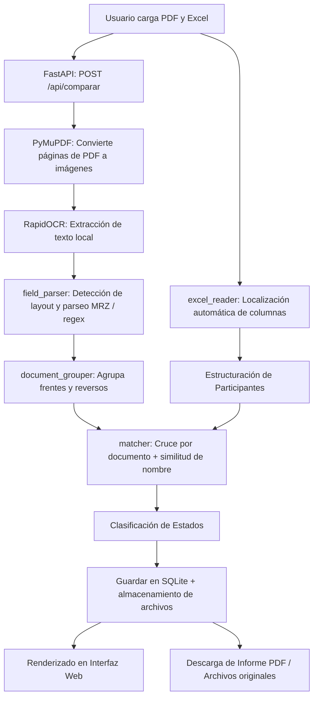

# Sistema de Verificación OCR de Documentos de Identidad 🇨🇴

Sistema automatizado para la extracción, lectura y verificación cruzada de documentos de identidad colombianos (Cédulas de Ciudadanía clásicas y digitales, Tarjetas de Identidad) escaneados en formato **PDF** contra reportes de inscripción en **Excel** (`.xls` / `.xlsx`).

Todo el procesamiento de OCR se realiza **100% de manera local y offline** mediante **RapidOCR (ONNX Runtime)**, garantizando la total privacidad de los datos personales sin requerir servicios en la nube ni conexión externa.

---

## 📋 Tabla de Contenidos

1. [Características Principales](#-características-principales)
2. [Arquitectura del Proyecto](#-arquitectura-del-proyecto)
3. [Flujo de Procesamiento](#-flujo-de-procesamiento)
4. [Formatos de Cédula Soportados](#-formatos-de-cédula-soportados)
5. [Requisitos del Sistema](#-requisitos-del-sistema)
6. [Instalación y Puesta en Marcha](#-instalación-y-puesta-en-marcha)
7. [Usuarios y Seguridad de Acceso](#-usuarios-y-seguridad-de-acceso)
8. [Vistas de la Aplicación Web](#-vistas-de-la-aplicación-web)
9. [Referencia de la API REST](#-referencia-de-la-api-rest)
10. [Base de Datos y Almacenamiento](#-base-de-datos-y-almacenamiento)
11. [Ajustes y Calibración](#-ajustes-y-calibración)
12. [Despliegue en Producción](#-despliegue-en-producción)

---

## ✨ Características Principales

- **OCR Local y Privado**: Utiliza modelos de ONNX Runtime para lectura de texto sin enviar datos sensibles a servicios de terceros.
- **Soporte Multi-formato de Documentos**: Reconoce Cédula Clásica (amarilla con hologramas), Cédula Digital (policarbonato con chip/QR) y lectura precisa de la zona de código mecánico **MRZ (ICAO TD1)**.
- **Agrupamiento Inteligente de Páginas**: Fusiona automáticamente caras frontales y dorsales que pertenecen al mismo titular.
- **Lector Flexible de Excel**: Detecta dinámicamente encabezados de columnas ("Identificación", "Nombres", "Apellidos", etc.) sin depender de posiciones de celdas fijas.
- **Motor de Coincidencia Difusa (Fuzzy Matching)**: Algoritmo tolerante a variaciones de orden (Nombre Apellido vs. Apellido Nombre), abreviaturas y leves ruidos de OCR.
- **Autenticación y Sesiones Seguras**: Sistema de autenticación mediante JWT (JSON Web Tokens) con contraseñas encriptadas con `bcrypt`.
- **Historial Completo de Auditoría**: Base de datos SQLite que registra cada comparación realizada, métricas de rendimiento y almacena los archivos originales asociados.
- **Generador de Reportes PDF Ejecutivos**: Exportación de informes detallados con gráficos estadísticos, estados clasificados y métricas mediante ReportLab.
- **Interfaz Web Moderna y Responsiva**: Dashboard interactivo con zonas de carga Drag & Drop, filtros de estado, vista previa de resultados y consulta de historial.

---

## 🏗 Arquitectura del Proyecto

```
Proyecto-OCR/
├── backend/
│   ├── app/
│   │   ├── __init__.py
│   │   ├── main.py                  # Servidor FastAPI, endpoints raíz y montaje estático
│   │   ├── auth.py                  # Generación y validación de tokens JWT y hashing bcrypt
│   │   ├── database.py              # Modelos SQLAlchemy (Usuario, Comparacion) y SQLite
│   │   ├── ocr_engine.py            # Conversión PDF a imagen (PyMuPDF) y motor RapidOCR
│   │   ├── field_parser.py          # Extracción por regex y heurísticas (layouts y MRZ)
│   │   ├── document_grouper.py      # Agrupación de páginas frontales/reversos por persona
│   │   ├── excel_reader.py          # Parser dinámico de reportes Excel (.xls/.xlsx)
│   │   ├── matcher.py               # Algoritmo de comparación y cálculo de similitud
│   │   ├── report_generator.py      # Generación de informes ejecutivos en PDF (ReportLab)
│   │   ├── schemas.py               # Modelos Pydantic de entrada y salida
│   │   └── routers/
│   │       ├── __init__.py
│   │       ├── auth_router.py       # Endpoints /api/auth (login, me)
│   │       └── historial_router.py  # Endpoints /api/historial (reportes, descargas, listado)
│   ├── storage/                     # Almacenamiento local de PDFs y Excels subidos
│   ├── ocr_system.db                # Base de datos SQLite autogenerada
│   ├── diagnostico_ocr.py           # Script CLI para pruebas y diagnósticos de OCR
│   ├── test_all_cases.py            # Suite de pruebas automatizadas
│   ├── test_full_match.py           # Pruebas de integración del motor de cruce
│   ├── test_ocr.py                  # Pruebas unitarias de extracción
│   ├── test_parser.py               # Pruebas de expresiones regulares de campos
│   └── requirements.txt             # Dependencias de Python
├── frontend/
│   ├── index.html                   # Panel principal de carga y resultados
│   ├── historial.html               # Panel de consulta de auditorías y descargas
│   ├── login.html                   # Vista de inicio de sesión
│   ├── app.js                       # Lógica de carga, peticiones y renderizado de resultados
│   ├── historial.js                 # Lógica de consulta de historial y descarga de informes
│   └── style.css                    # Hoja de estilos con variables y diseño responsivo
├── run.bat                          # Script de arranque para Windows
├── run.sh                           # Script de arranque para Linux / macOS
└── README.md                        # Documentación técnica del proyecto
```

---

## 🔄 Flujo de Procesamiento



1. **Recepción de Archivos**: El usuario autenticado envía el PDF con las cédulas y el archivo Excel desde el dashboard.
2. **Conversión y OCR**: PyMuPDF renderiza cada página en memoria sin requerir Poppler. RapidOCR ejecuta la inferencia de texto.
3. **Parseo de Campos**: `field_parser.py` limpia el texto, elimina stop-words oficiales y extrae número de documento, nombres, apellidos, fechas y datos de zona MRZ.
4. **Agrupamiento**: `document_grouper.py` asocia páginas consecutivas pertenecientes a una misma persona.
5. **Lectura de Excel**: `excel_reader.py` escanea las hojas del libro buscando la fila de cabecera con columnas de identificación y nombres.
6. **Comparación Inteligente**: `matcher.py` clasifica cada registro en:
   - 🟢 **Coincide**: Documento y nombre validados satisfactoriamente.
   - 🟡 **Nombre no coincide**: Mismo número de identificación pero discrepancia en el nombre detectado.
   - 🟠 **Datos incompletos**: Cédula detectada sin número legible o datos faltantes.
   - 🔴 **No encontrado en PDF**: Registrado en el Excel pero ausente en el documento PDF escaneado.
   - ℹ️ **Sobrantes en PDF**: Documentos presentes en el PDF que no figuran en la lista de inscripción de Excel.

---

## 🪪 Formatos de Cédula Soportados

| Tipo de Documento | Características Reconocidas | Mecanismo de Extracción |
| :--- | :--- | :--- |
| **Cédula Clásica (Amarilla)** | Fondo amarillo, hologramas, huella, firma del titular. | Extracción heurística por palabras clave (`NUMERO`, `APELLIDOS`, `NOMBRES`). |
| **Cédula Digital (Policarbonato)** | Documento moderno, chip integrado, código QR, mariposas. | Heurísticas posicionales y etiquetas estándar. |
| **Zona MRZ (ICAO 9303 / TD1)** | 3 líneas de 30 caracteres en el reverso de la cédula digital. | Parser MRZ de alta fidelidad con verificación de checksums. |
| **Tarjeta de Identidad** | Documentos para menores de edad en formatos azul / rosado. | Identificación por encabezados y patrones de NUIP. |

---

## 💻 Requisitos del Sistema

- **Python**: Versión `3.10` o superior (`3.10` - `3.12` recomendadas).
- **Sistema Operativo**: Windows 10/11, Linux (Ubuntu 20.04+, Debian, CentOS) o macOS.
- **Dependencias del Sistema (Linux)**:
  ```bash
  sudo apt update && sudo apt install -y libgl1 libglib2.0-0
  ```

---

## 🚀 Instalación y Puesta en Marcha

### Opción 1: Ejecución Automática con Scripts

El proyecto incluye scripts que se encargan de crear el entorno virtual, instalar las dependencias y levantar el servidor:

#### En Windows:
Haga doble clic en `run.bat` o ejecútelo desde la terminal:
```cmd
run.bat
```

#### En Linux / macOS:
Otorgue permisos de ejecución y ejecute `run.sh`:
```bash
chmod +x run.sh
./run.sh

# Windows
run.bat
```

El script crea un entorno virtual, instala dependencias (la primera vez
tarda unos minutos porque descarga los modelos de RapidOCR) y levanta el
servidor en `http://localhost:8000`. Abre esa URL en el navegador: el
propio backend sirve el frontend.

La primera ejecución de OCR también descargará los modelos ONNX de
RapidOCR (unos ~15 MB) y los dejará cacheados localmente.

## Endpoints de la API

| Método | Ruta                | Descripción                                          |
|--------|----------------------|-------------------------------------------------------|
| POST   | `/api/extract-pdf`  | Solo OCR + parsing del PDF (útil para depurar)        |
| POST   | `/api/parse-excel`  | Solo lectura del Excel (útil para depurar)            |
| POST   | `/api/comparar`     | Flujo completo: OCR + Excel + comparación             |
| GET    | `/api/health`       | Chequeo de salud                                       |

Puedes probar `/api/extract-pdf` y `/api/parse-excel` por separado (con
Swagger en `http://localhost:8000/docs`) para revisar qué está
reconociendo el OCR antes de correr la comparación completa.

## Limitaciones conocidas / próximos ajustes

- **Los regex de `field_parser.py` están calibrados con los formatos de
  cédula que revisamos**, pero el OCR nunca es 100% determinístico. Si
  ves campos vacíos o mal separados en varios documentos, lo más
  eficiente es:
  1. Probar `/api/extract-pdf` solo, mirar el JSON de salida.
  2. Revisar qué texto crudo devolvió RapidOCR para esa página
     (se puede exponer fácilmente agregando `raw_text` a la respuesta).
  3. Ajustar la palabra clave o el rango de búsqueda en
     `field_parser.py` (todas las funciones `parse_*` son independientes
     y fáciles de tocar sin afectar el resto).
- El agrupamiento de páginas (`document_grouper.py`) asume que, dentro
  de una misma cédula, la página con el **número de documento** viene
  antes que las páginas de reverso sin número. Si el PDF llega
  desordenado, el agrupamiento fallará; se puede mitigar detectando
  también el nombre y agrupando por similitud si hace falta.
- El umbral de similitud de nombres (`NAME_MATCH_THRESHOLD = 0.72` en
  `matcher.py`) es ajustable. Bájalo si el Excel trae nombres muy
  abreviados; súbelo si quieres ser más estricto.
- Actualmente el procesamiento es **síncrono** (el usuario espera a que
  termine el OCR). Con PDFs grandes (+50 páginas) conviene pasar esto a
  un job en background con progreso (Celery/RQ o `BackgroundTasks` de
  FastAPI + polling) — dejo la arquitectura lista para ese cambio porque
  la lógica ya está separada del endpoint.
- Antes de subir a un VPS: correr detrás de Nginx + gunicorn/uvicorn con
  varios workers, y limitar tamaño de archivo también a nivel de Nginx
  (`client_max_body_size`).
